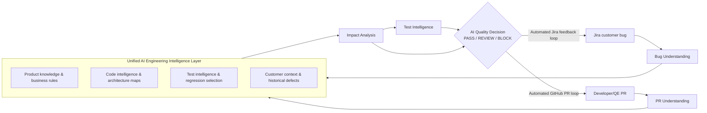

# AI Engineering Quality & Impact Platform

A unified agentic AI platform for Conga CLM that connects **customer Jira bugs**, **development code**
(ROC-CLM-API, ROC-CLM-UI) and **test automation code** (rlpclm-automation) through one shared intelligence layer.
It has two entry points:

1. **Autonomous PR Quality Intelligence (Development Track).** For a GitHub PR it reads the diff and the linked
   Jira ticket(s) and determines impacted code, classes, methods, APIs, config, feature flags, workflows,
   dependencies and customer impact. It then selects the regression scope from the automation repo, triggers
   those tests, analyses failures and gives an evidence-based **PASS / REVIEW / BLOCK** recommendation, posted
   as a PR comment plus a commit status or check.
2. **Customer-Aware Agentic AI (Customer Track).** For a Jira customer bug it works out the business behaviour,
   reproduction steps and customer context. It then searches the dev repos for the likely root cause and impacted
   code, picks the regression scope, and posts the first AI analysis comment back into the ticket. That comment
   covers the root-cause hypothesis, code impact, regression scope and which developer to notify.

Everything runs in **dry-run mode by default**: it prints the PR comment or Jira comment it *would* post.
It only writes to GitHub or Jira when you pass `--post` or set `AIQ_POST=true`.

## Architecture (mapped to the target diagram)



| Diagram element | Implementation |
|---|---|
| Customer Track: Jira bug -> Bug Understanding | `connectors/jira.py`, `analysis/bug_understanding.py` |
| Development Track: PR -> PR Understanding | `connectors/github.py`, `analysis/pr_understanding.py`, `analysis/diff.py` |
| Product Knowledge & Business Rules | `intelligence/knowledge.py` + `connectors/docs.py` (documentation.conga.com CLM sitemap; 1,206 pages pre-indexed in `data/knowledge/`) |
| Code Intelligence & Architecture Maps | `intelligence/code_index.py`, `intelligence/csharp.py` (types, methods, ASP.NET routes, feature flags, config keys, reverse dependencies, UI API calls, git ownership) |
| Test Intelligence & Regression Selection Rules | `intelligence/test_index.py` (TestNG/JUnit, NUnit/MSTest/xUnit, Playwright/Jest/Cypress, pytest, Gherkin + optional mapping file) |
| Customer Context & Historical Defects | `intelligence/defects.py` (Jira dashboard 36628 -> gadget filters -> JQL) |
| Shared join key | `taxonomy.py` (CLM functional areas used by code, tests, docs and defects) |
| Impact Analysis | `analysis/impact.py`, `analysis/root_cause.py` |
| Test Intelligence (selection, gaps, execution, failure analysis) | `analysis/test_selection.py`, `execution/` |
| AI Quality Decision | `decision.py` |
| Automated GitHub PR loop / Automated Jira feedback loop | `feedback.py`, `reporting/` |
| Agentic AI (pluggable LLM) | `llm.py` |

See [docs/architecture.md](docs/architecture.md) for the full mapping and design decisions.

**How "agentic" works here:** deterministic tools gather the evidence first: diff parsing, index lookups,
dependency walks, test selection, execution and JUnit parsing. The LLM, if one is configured, then synthesises
that evidence into a change summary, requirement alignment, review concerns, failure triage and the root-cause
narrative. The quality gate stays rule-based and cites its evidence. LLM concerns can raise PASS to REVIEW but
can never BLOCK on their own. With no LLM, the full report is still produced.

## Setup

Requires Python 3.10+.

```bash
pip install -e ".[dev]"
aiqip --help
```

### Environment variables / secrets

All secrets come from environment variables (or GitHub Actions secrets). Nothing secret is read from
`aiqip.yaml`. Never commit them.

| Variable | Required for | Notes |
|---|---|---|
| `AIQ_GITHUB_TOKEN` (or `GITHUB_TOKEN`/`GH_TOKEN`) | both tracks | Read: `congaengr/ROC-CLM-API`, `ROC-CLM-UI`, `rlpclm-automation` (SSO-authorised for the org). Write (only for `--post`): pull-request comments + commit statuses on the dev repo; `actions:write` on the automation repo for test execution. |
| `JIRA_BASE_URL` | both | Default `https://conga.atlassian.net` |
| `JIRA_EMAIL`, `JIRA_API_TOKEN` | both | Atlassian API token of a user/service account that can browse the CONTRACTS project and dashboard 36628; comment permission for `--post`. |
| `AIQ_LLM_PROVIDER` | optional | `none` (default), `openai` (any OpenAI-compatible endpoint), `azure-openai`, `anthropic`, or `my.module:MyProvider` |
| `AIQ_LLM_API_KEY` (or `OPENAI_API_KEY`/`ANTHROPIC_API_KEY`/`AZURE_OPENAI_API_KEY`) | with an LLM | |
| `AIQ_LLM_MODEL`, `AIQ_LLM_BASE_URL`, `AIQ_LLM_API_VERSION` | optional | Base URL for gateways/Azure deployments (`https://<res>.openai.azure.com/openai/deployments/<deployment>`) |
| `AIQ_POST` | optional | `true` to post results (default `false` = dry run) |
| `AIQ_EXECUTE` | webhook server | `true` to trigger test execution from webhooks |
| `AIQ_TEST_EXECUTOR` | optional | `none` (default), `github-workflow`, `command`, `junit` |
| `AIQ_INDEX_DIR`, `AIQ_CONFIG` | optional | Index location (default `.aiqip/index`), config path (default `./aiqip.yaml`) |
| `AIQ_GITHUB_WEBHOOK_SECRET`, `AIQ_JIRA_WEBHOOK_SECRET`, `AIQ_JIRA_ISSUE_TYPES` | `aiqip serve` | Webhook verification; issue types to analyse (default `Bug`) |

Non-secret settings live in [`aiqip.yaml`](aiqip.yaml): repos and branches, dashboard id, docs sitemaps,
executor, and gate thresholds.

Check connectivity with:

```bash
aiqip doctor
```

### Build the intelligence layer

```bash
aiqip index code       # blobless clones of ROC-CLM-API and ROC-CLM-UI into .aiqip/repos (or --path <checkout>)
aiqip index tests      # rlpclm-automation (optionally --mapping aiqip-test-map.yaml)
aiqip index defects    # resolves dashboard 36628's filters to JQL (or --jql "...", repeatable)
aiqip index docs --fetch-content   # optional refresh; a pre-built CLM docs index ships in data/knowledge/
```

The nightly `Refresh Intelligence Index` workflow does this in CI and caches the result for the other
workflows.

## Use case 1: PR quality gate

```bash
# dry run: prints the PR comment and the commit status it would set
aiqip pr-quality --repo congaengr/ROC-CLM-API --pr 2248 --out report/

# trigger the configured regression executor as well
aiqip pr-quality --repo congaengr/ROC-CLM-API --pr 2248 --execute

# actually post the comment + "AI Quality Gate" status (explicit opt-in)
aiqip pr-quality --repo congaengr/ROC-CLM-API --pr 2248 --execute --post
```

The PR comment has these sections: Recommendation (with evidence), Change summary, Jira traceability
(ticket, status, requirement alignment), Change impact (functional areas, risk factors, classes, methods, APIs,
configuration, feature flags, workflows, dependencies, dependents/blast radius incl. UI callers, migrations,
customer impact, related historical defects, relevant product docs), Regression scope & results (selected tests
with reasons and outcomes, failure analysis), and Test gaps. The comment is upserted, so re-runs update it
instead of adding new ones. The gate is reported as a commit status (`report_mode: status`; REVIEW maps to
`review_state`, default `pending`) or as a check run (`report_mode: check`: success / neutral / failure).

Decision rules (`decision.py`, thresholds in `aiqip.yaml`):

* **BLOCK** when a selected regression test fails and is classified as a product regression (or the failure is
  unexplained).
* **REVIEW** when any of these hold: no Jira link, the linked Jira can't be read, no tests selected, tests
  selected but not executed, a high-severity test gap, risk score at or above `high_risk_score`,
  environment/test-maintenance failures, or LLM review concerns.
* **PASS** otherwise.

**Test execution.** Choose one executor:

* `github-workflow` dispatches `aiqip-regression.yml` in the automation repo with the framework-native filter
  of the selected tests, waits for the run and parses the `junit-results` artifact. The template and its
  contract are in [templates/automation-repo/aiqip-regression.yml](templates/automation-repo/aiqip-regression.yml).
* `command` runs a local command template such as `mvn test -Dtest={filter}`, then parses JUnit XML.
* `junit` ingests results produced elsewhere.

**Automation:**

* [templates/dev-repo/aiqip-pr-quality.yml](templates/dev-repo/aiqip-pr-quality.yml) is a drop-in workflow
  for ROC-CLM-API/UI that runs on every PR update. It reports to the job summary until the repo variable
  `AIQ_POST` is set to `true`.
* [.github/workflows/pr-quality-gate.yml](.github/workflows/pr-quality-gate.yml) runs on demand from this repo
  (`workflow_dispatch`, dry run by default) or can be reused through `workflow_call`.
* `aiqip serve` is a webhook server that accepts GitHub `pull_request` events on `/webhooks/github`.

## Use case 2: customer bug analysis

```bash
aiqip bug-analysis --issue CONTRACTS-12345 --out report/          # dry run: prints the Jira comment
aiqip bug-analysis --issue CONTRACTS-12345 --post                 # post the first AI analysis comment
```

The comment (Atlassian Document Format) contains: bug understanding (business behaviour, repro steps,
customer context, functional areas), root-cause hypothesis with confidence, code impact (ranked files with
reasons, APIs, dependents), regression scope and test gaps, related historical defects, product documentation,
the suggested developer to notify (from git ownership / CODEOWNERS / commit authors), and next steps. When
posting, it skips issues that already have an AI analysis comment unless you pass `--force`.

**Automation:** [.github/workflows/jira-bug-analysis.yml](.github/workflows/jira-bug-analysis.yml) is
triggered by Jira Automation through `repository_dispatch` (see
[docs/jira-automation.md](docs/jira-automation.md)), or manually. You can also point a Jira webhook at
`aiqip serve` on `/webhooks/jira`.

## Offline demo, fixtures and tests

```bash
python -m pytest -q                          # unit + end-to-end tests (no network)
bash examples/synthetic/run_demo.sh          # both use cases on a SYNTHETIC sample, dry run
```

`examples/synthetic/` is a small, clearly-labelled synthetic CLM-like API, UI and automation repo with
recorded-format GitHub/Jira payloads (`example-org`, `SYNTH-*`). It is **not** Conga data. Its outputs are
committed in [examples/output/](examples/output/).

To replay real data offline, record it once with access, then rerun from fixtures:

```bash
aiqip snapshot pr --repo congaengr/ROC-CLM-API --pr 2248 --out fixtures/
aiqip snapshot jira --issue CONTRACTS-44346 --out fixtures/
aiqip pr-quality --repo congaengr/ROC-CLM-API --pr 2248 --fixtures fixtures/
```

## Reference sample: ROC-CLM-API PR 2248

See [examples/pr-2248/README.md](examples/pr-2248/README.md). The dry run could not be executed from the build
environment: the congaengr repos return 404 to its GitHub token, and Jira needs credentials. That file has the
exact commands to generate and commit the report once credentials are set.

## Repository layout

```text
src/aiqip/
  cli.py, server.py, config.py, llm.py, feedback.py, decision.py, taxonomy.py, text.py, models.py
  connectors/   github.py, jira.py, docs.py, fixtures.py
  intelligence/ code_index.py, csharp.py, test_index.py, knowledge.py, defects.py, layer.py
  analysis/     pr_understanding.py, bug_understanding.py, diff.py, impact.py, root_cause.py, test_selection.py
  execution/    executors.py, junit.py, failure_analysis.py
  reporting/    pr_report.py, jira_report.py, adf.py
  workflows/    pr_quality.py, customer_bug.py
data/knowledge/clm-docs-index.json      pre-built CLM documentation index (public docs)
templates/                              workflows to install in the dev and automation repos
examples/                               synthetic demo, outputs, PR 2248 runbook
.github/workflows/                      CI, PR Quality Gate, Jira Bug Analysis, Refresh Intelligence Index
```

## Known limitations / next steps

* The C# analysis is regex-based. It doesn't resolve overloads, partial classes across files, or generic type
  arguments precisely. Roslyn-based extraction can be added behind `intelligence/csharp.py`.
* Retrieval uses BM25 over identifiers and prose. Embeddings can be added behind the same `search()`
  interfaces if recall on paraphrased bug reports proves insufficient.
* The functional-area taxonomy is a first cut from the CLM documentation structure. Tune it and add
  `aiqip-test-map.yaml` rules once the real automation repo is indexed.
* Historical defects -> fixing PRs (Jira development panel) is available in `JiraClient.linked_pull_requests`
  but isn't used for ranking yet.
