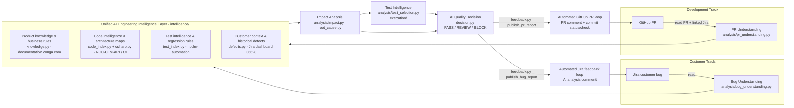

# Architecture

The platform implements the target diagram ("AI Engineering Quality & Impact Platform"): two entry
points (Customer Track and Development Track) share one intelligence layer and one analysis core,
and each track ends in an automated feedback loop.

## Diagram box -> code

| Diagram element | Module(s) | What it does |
|---|---|---|
| Jira Customer Bug (ticket) | `connectors/jira.py` | Jira Cloud REST v3: issue (with field names, so customer-specific custom fields are recognised), comments, JQL search (`/search/jql` with page tokens), dashboard -> gadget -> filter -> JQL resolution, ADF comments. |
| Bug Understanding | `analysis/bug_understanding.py` | Business behaviour, reproduction steps, expected/actual, customer context (customer/account/severity/environment fields, priority, versions, labels), error signatures, API routes and code identifiers mentioned, functional areas. |
| Developer/QE PR | `connectors/github.py` | PR metadata, files + patches (paginated), commits; writes PR comment (upsert by hidden marker), commit status or check run, workflow dispatch, artifact download. |
| PR Understanding | `analysis/pr_understanding.py`, `analysis/diff.py` | File categories (code/test/config/build/migration/ui/docs), changed classes and methods (hunk-context aware), Jira keys from title/body/branch/commits (e.g. `Fixes # https://conga.atlassian.net/browse/CONTRACTS-44346`), change vocabulary, functional areas. |
| Product Knowledge & Business Rules | `intelligence/knowledge.py`, `connectors/docs.py` | Crawls the CLM sitemap(s) of documentation.conga.com, extracts article text, classifies pages into functional areas, BM25 search. A pre-built index of the 1,206 "CLM for Advantage Platform" pages ships in `data/knowledge/`. |
| Code Intelligence & Architecture Maps | `intelligence/code_index.py`, `intelligence/csharp.py` | Per-file namespace, types (with base types), methods, ASP.NET routes (class + action attribute routes, minimal APIs), feature-flag reads, configuration keys, referenced identifiers (reverse-dependency map), csproj references, UI HTTP calls, git ownership + CODEOWNERS. |
| Test Intelligence & Regression Selection Rules | `intelligence/test_index.py` | Discovers tests across TestNG/JUnit, NUnit/MSTest/xUnit, Playwright/Jest/Cypress, pytest and Gherkin; extracts tags/groups/categories, API routes called, keywords; maps to functional areas; optional `aiqip-test-map.yaml` rules for QE-curated mapping. |
| Customer Context & Historical Defects | `intelligence/defects.py` | Escape defects / customer bugs from the dashboard's filters (+ extra JQL), BM25 similarity, area statistics. |
| Shared functional-area taxonomy | `taxonomy.py` | The join key between code, tests, docs and defects (agreement lifecycle, document generation, validation rules, approvals, eSignature, activation, amend/renew/terminate, ...). |
| Impact Analysis | `analysis/impact.py`, `analysis/root_cause.py` | Code / classes / methods / APIs (direct and indirect via dependents) / config / feature flags / workflows / DI and package dependencies / dependents (incl. UI callers of changed routes) / data migrations / customer impact / related defects / docs, plus an explainable risk score. For bugs: ranked root-cause candidates and suggested owners. |
| Test Intelligence (impacted tests -> regression selection; test gap -> execution) | `analysis/test_selection.py`, `execution/` | Scores every automation test against impacted areas, routes and vocabulary; detects gaps (untested areas, untested endpoints, new types without tests); builds framework-native filters; executes via `github-workflow` (dispatch to the automation repo), `command` or `junit`; parses JUnit; triages failures (product regression / environment / test maintenance / test data). |
| AI Quality Decision (PASS / REVIEW / BLOCK) | `decision.py` | Deterministic, evidence-cited gate; the LLM can only add review concerns (never BLOCK on its own). |
| Automated GitHub PR loop | `feedback.publish_pr_report`, `reporting/pr_report.py` | PR comment (change impact, Jira traceability, selected tests and results, failure analysis, test gaps, recommendation) and commit status / check run. |
| Automated Jira feedback loop | `feedback.publish_bug_report`, `reporting/jira_report.py`, `reporting/adf.py` | First AI analysis comment (root-cause hypothesis, code impact, regression scope, related defects, docs, developer to notify) in ADF; skips if an analysis already exists. |
| "Agentic AI" | `llm.py`, workflows | Pluggable LLM (none / OpenAI-compatible / Azure OpenAI / Anthropic / custom class) used to synthesise the change summary, requirement alignment, review concerns, failure triage and the root-cause narrative over the evidence gathered by the deterministic tools. |

## Design choices

* **Deterministic first, LLM second.** Every recommendation is backed by evidence the platform collected
  itself (diff, index lookups, test results). Without an LLM the platform still produces the complete report;
  with one, it adds synthesis. LLM failures degrade gracefully.
* **Dry run by default.** Only `feedback.py` writes to GitHub/Jira and only when `--post` / `AIQ_POST=true`.
  Test execution (which dispatches workflows) needs `--execute` / `AIQ_EXECUTE=true` separately.
* **No heavyweight dependencies.** Python 3.10+, `httpx` and `PyYAML` only; BM25 retrieval is built in, so it
  runs in any CI runner and on-prem without a vector database. The index format is plain JSON and can be
  swapped for embeddings later behind the same `search()` interfaces.
* **Regex-level C# analysis.** Roslyn would be more precise but requires a .NET SDK and a buildable solution in
  CI; the regex extractor covers what impact analysis needs (types, members, routes, flags, config, references).
* **Framework-agnostic test intelligence.** The automation repo's stack could not be inspected from the build
  environment, so discovery supports the common Java/.NET/JS/Python/BDD stacks and records the detected
  framework, which also drives the execution filter syntax.
